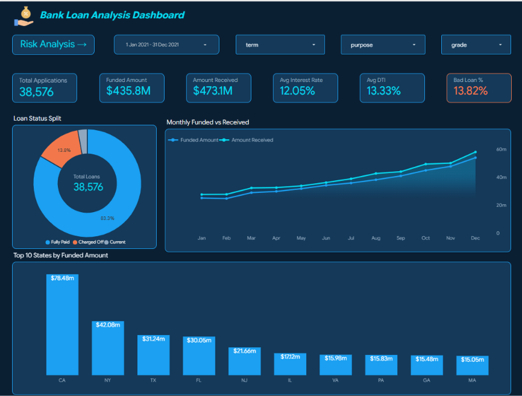
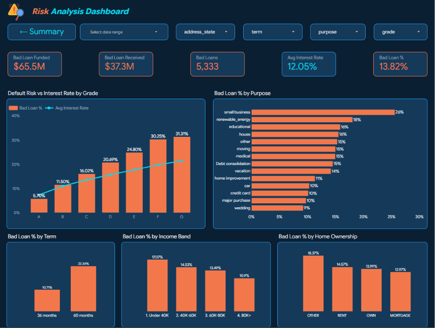

# Bank Loan Analysis Dashboard

A two-page interactive **Looker Studio** dashboard that analyses **38,576 bank loans issued in 2021**. It shows how large and fast-growing the loan book is, how much of it goes bad, and which borrower and loan segments carry the most default risk.

**Live dashboard:** https://datastudio.google.com/reporting/23268deb-1073-451a-a80d-c0bbea43143d

---

## Screenshots

**Page 1: Bank Loan Analysis Dashboard (Summary)**



**Page 2: Risk Analysis Dashboard**



---

## Business Problem

> A bank wants to monitor its loan portfolio and understand which borrower segments carry the most default risk, so it can improve approval decisions.

### Business questions the dashboard answers

| # | Question | Page |
|---|---|---|
| Q1 | How big is the loan book, and how is funding trending month over month? | Summary |
| Q2 | What share of loans are Fully Paid, Current or Charged Off? | Summary |
| Q3 | Is the money lent coming back? | Summary |
| Q4 | Where does the lending go geographically? | Summary |
| Q5 | How much money is tied up in bad loans, and how much came back? | Risk |
| Q6 | Do riskier grades default more, and are they priced for it? | Risk |
| Q7 | Which loan purposes fail most often? | Risk |
| Q8 | Is a 60-month loan riskier than a 36-month loan? | Risk |
| Q9 | Do lower-income borrowers default more? | Risk |
| Q10 | Does home ownership affect default? | Risk |

---

## Data Source

| Item | Detail |
|---|---|
| Platform | Kaggle |
| Dataset | **Bank Loan Report** |
| Dataset link | https://www.kaggle.com/datasets/shahidkhan01174/bank-loan-report?select=financial_loan.csv |
| File used | `financial_loan.csv` (7.81 MB) |
| Size | 38,576 rows x 24 columns (one row per loan) |
| Period | January to December 2021 (all loans issued in 2021) |
| Currency | Not stated in the file; shown in US dollars ($) because borrower states are US states |

The Kaggle page has no official description for the file, so the column meanings below are interpreted from the column names and values.

### Sample records (first 5 of 38,576 rows, 9 of 24 columns)

| id | address_state | grade | term | purpose | loan_amount | int_rate | loan_status | total_payment |
|---|---|---|---|---|---|---|---|---|
| 1077430 | GA | C | 60 months | car | 2,500 | 0.1527 | Charged Off | 1,009 |
| 1072053 | CA | E | 36 months | car | 3,000 | 0.1864 | Fully Paid | 3,939 |
| 1069243 | CA | C | 36 months | car | 12,000 | 0.1596 | Charged Off | 3,522 |
| 1041756 | TX | B | 60 months | car | 4,500 | 0.1065 | Fully Paid | 4,911 |
| 1068350 | IL | A | 36 months | car | 3,500 | 0.0603 | Fully Paid | 3,835 |

### Data dictionary

| # | Column | Meaning | Use in dashboard |
|---|---|---|---|
| 1 | `id` | Unique loan identifier | Yes: loan count |
| 2 | `address_state` | US state of the borrower | Yes: Top 10 States, State filter |
| 3 | `application_type` | Application type (only value: INDIVIDUAL) | Removed: single value |
| 4 | `emp_length` | Length of employment | Kept, not charted |
| 5 | `emp_title` | Job title or employer (1,433 blanks) | Removed: free text, blanks |
| 6 | `grade` | Risk grade assigned to the loan (A to G) | Yes |
| 7 | `home_ownership` | RENT, MORTGAGE, OWN, OTHER or NONE | Yes |
| 8 | `issue_date` | Date the loan was issued | Yes: monthly trend, date filter |
| 9 | `last_credit_pull_date` | Most recent credit check | Kept, not charted |
| 10 | `last_payment_date` | Date of latest payment | Kept, not charted |
| 11 | `loan_status` | Fully Paid, Current or Charged Off | Yes |
| 12 | `next_payment_date` | Date next payment is due | Kept, not charted |
| 13 | `member_id` | Borrower identifier | Removed: not needed |
| 14 | `purpose` | Reason for the loan (14 categories) | Yes |
| 15 | `sub_grade` | Finer grade within a grade | Kept, not charted |
| 16 | `term` | 36 or 60 months | Yes |
| 17 | `verification_status` | Income verification status | Kept, not charted |
| 18 | `annual_income` | Annual income of the borrower | Yes: Income Band |
| 19 | `dti` | Debt-to-income ratio | Yes: Avg DTI |
| 20 | `installment` | Monthly installment amount | Kept, not charted |
| 21 | `int_rate` | Interest rate | Yes |
| 22 | `loan_amount` | Principal funded | Yes |
| 23 | `total_acc` | Total credit accounts | Kept, not charted |
| 24 | `total_payment` | Total received from the borrower to date | Yes |

---

## Tools

- **Kaggle:** data source
- **Microsoft Excel:** data checks, helper columns, benchmark numbers
- **Google Sheets:** data host for the dashboard
- **Looker Studio:** dashboard, calculated fields, filters

---

## Project Workflow

1. **Define** the problem, business questions and KPIs
2. **Prepare** the data in Excel (checks and helper columns)
3. **Connect** the cleaned file to Looker Studio through Google Sheets
4. **Validate** six headline numbers against Excel before building any chart
5. **Build** two dashboard pages, one chart at a time, each answering one question
6. **Publish** the report and test it in a private browser window
7. **Document** the findings and recommendations

### Data preparation

| Check | Result |
|---|---|
| Rows and columns | 38,576 rows, 24 columns |
| Duplicate loans | None (all `id` values unique) |
| Blank values | Only `emp_title` (1,433 rows, about 3.7%); column removed |
| `int_rate`, `dti` | Stored as decimals; formatted as percentages |
| Dates | Day-first in the raw file; `issue_date` reformatted to yyyy-mm-dd |
| Columns removed | `application_type`, `emp_title`, `member_id` |
| Columns added | `loan_category`, `issue_month_no.`, `issue_month`, `issue_year` |
| Home ownership NONE | Only 3 loans; excluded from the Home Ownership chart only |

**Good vs Bad Loan:** Bad = Charged Off. Good = Fully Paid or Current.

### Calculated fields in Looker Studio

```text
Bad Loan Count = COUNT_DISTINCT(CASE WHEN loan_status = "Charged Off" THEN id END)

Bad Loan %     = Bad Loan Count / COUNT_DISTINCT(id)

Income Band    = CASE
                   WHEN annual_income < 40000 THEN "1. Under 40K"
                   WHEN annual_income < 60000 THEN "2. 40K-60K"
                   WHEN annual_income < 80000 THEN "3. 60K-80K"
                   ELSE "4. 80K+"
                 END
```

Display-only text labels were also created for the money cards (for example `Funded Amount Label`) so large values show as `$435.8M`.

### Validation (Excel vs Looker Studio)

| Metric | Excel | Looker Studio | Match |
|---|---|---|---|
| Total Applications | 38,576 | 38,576 | Yes |
| Funded Amount | 435,757,075 | $435,757,075 | Yes |
| Amount Received | 473,070,933 | $473,070,933 | Yes |
| Avg Interest Rate | 0.1205 | 12.05% | Yes |
| Avg DTI | 0.1333 | 13.33% | Yes |
| Bad Loan % | 0.1382 | 13.82% | Yes |

---

## Dashboard Overview

### Page 1: Bank Loan Analysis Dashboard (Summary)

- **KPI cards:** Total Applications, Funded Amount, Amount Received, Avg Interest Rate, Avg DTI, Bad Loan %
- **Loan Status Split** (donut)
- **Monthly Funded vs Received** (line)
- **Top 10 States by Funded Amount** (column)
- **Filters:** date range, term, purpose, grade

### Page 2: Risk Analysis Dashboard

- **KPI cards:** Bad Loan Funded, Bad Loan Received, Bad Loans, Avg Interest Rate, Bad Loan %
- **Default Risk vs Interest Rate by Grade** (combo)
- **Bad Loan % by Purpose** (bar)
- **Bad Loan % by Term**, **by Income Band**, **by Home Ownership** (columns)
- **Filters:** date range, state, term, purpose, grade

Orange is used only for bad loans and risk; blue and cyan are used for everything else.

---

## Key Findings

| KPI | Value |
|---|---|
| Total Applications | 38,576 |
| Funded Amount | $435.8M |
| Amount Received | $473.1M (8.6% above funded) |
| Avg Interest Rate | 12.05% |
| Avg DTI | 13.33% |
| Bad Loan % | 13.82% (5,333 loans) |

1. **The book is large and growing.** $435.8M was funded across 38,576 loans (average loan about $11.3K). Monthly funding rose from about $25M in January to about $54M in December (read from the chart).
2. **It has returned more cash than it lent.** Amount Received is $473.1M against $435.8M funded, about $37.3M (8.6%) more, including losses. This is cash, not profit: the data has no cost information.
3. **Roughly one loan in seven goes bad.** The donut shows 83.3% Fully Paid, 13.8% Charged Off and about 2.9% Current. Even if every Current loan defaulted, the bad-loan rate would be about 16.7%.
4. **Bad loans cost about $28.2M.** $65.5M was lent on charged-off loans and $37.3M came back (about 57%). Bad loans are about 15.0% of the money lent but 13.82% of loans, so they skew slightly larger.
5. **Grade is the strongest risk signal.** Bad Loan % rises from **5.70% (A) to 31.31% (G)**. The average interest rate also rises, but from about grade C the default rate is above the average rate charged (rates read from the chart).
6. **60-month loans default about twice as often** as 36-month loans: **22.34% vs 10.71%**.
7. **Small business is the riskiest purpose at 26%**, almost double the 13.82% average, followed by renewable energy (18%). Wedding is lowest at 9%.
8. **Lower incomes default more:** 17.07% under 40K, 14.53% for 40K to 60K, 13.49% for 60K to 80K and 10.9% at 80K and above.
9. **Home ownership is a weak signal:** RENT 14.57%, OWN 13.99%, MORTGAGE 12.97%. OTHER (18.37%) has only 98 loans, and NONE (3 loans) is excluded from the chart.
10. **Lending is concentrated:** California is $78.48M (18.0% of funding) and the top 10 states are about $283.0M (64.9%).

## Recommendations

- Review pricing and approval rules for **grades D to G**
- Apply stricter criteria or higher pricing to **60-month loans**
- Add extra underwriting checks for **small-business loans**
- Use **income with DTI** as a secondary screen for borrowers under 40K
- Do not rely on **home ownership** as a primary approval factor
- Monitor **regional concentration** (California and the top 10 states)
- Track **Current loans** and refresh the dashboard as new data arrives

## Limitations

- One year of data (2021): trends are month to month; there is no year-over-year comparison
- Each chart shows one factor at a time; grade, term and purpose may overlap
- Default rate and interest rate are different measures, so the pricing finding is a signal, not a loss calculation
- Amount Received includes interest and is not profit
- Small groups (OTHER home ownership: 98 loans) and loan counts per purpose are not shown on the dashboard
- Monthly funded amounts and average interest rate by grade were read from charts; hover over the dashboard for exact values
- Currency is not stated in the file; amounts are shown in US dollars

---

## Repository Structure

```text
bank-loan-analysis-dashboard/
|-- README.md
|-- images/
|   |-- summary-page.png
|   `-- risk-page.png
|-- docs/
|   |-- 01_Business_Questions_and_Objectives.docx
|   `-- 02_Business_Insights_and_Conclusions.docx
`-- data/
    |-- financial_loan.csv            (raw, from Kaggle)
    `-- financial_loan_clean.csv      (cleaned, dashboard source)
```


## Author

**Md Ziaul Haque**  
Data Analyst | Excel, SQL, Power BI, Tableau, Python  
GitHub: https://github.com/md-ziaul-haque-ds 
LinkedIn: http://www.linkedin.com/in/mdziaulhaque-datascience
